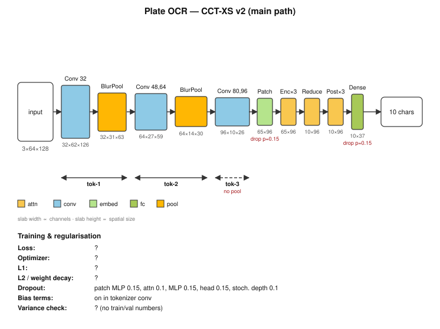

# Plate OCR — CCT-XS v2

| Lớp | Cấu hình | Output |
|---|---|---|
| Input | RGB 64×128, ×1/255 | 3×64×128 |
| Conv | 3×3 valid, 32, SiLU | 32×62×126 |
| MaxBlurPool | pool 2, blur 3 | 32×31×63 |
| Conv ×2 | 3×3 valid, 48 → 64, SiLU | 64×27×59 |
| MaxBlurPool | pool 2, blur 3 | 64×14×30 |
| Conv ×2 | 3×3 valid, 80 → 96, SiLU | 96×10×26 |
| Patch + MLP + PosEmb | patch 2, MLP 96, drop 0.15 | 65 token × 96 |
| Transformer encoder ×3 | 2 heads, dim 96, DyT norm, attn drop 0.1, MLP drop 0.15, stochastic depth 0.1 | 65 × 96 |
| Token reducer | 2 heads, query residual, output norm | 10 × 96 |
| Post-reducer ×3 | | 10 × 96 |
| Dense softmax | 37 lớp (0-9 A-Z _), head drop 0.15 | 10 × 37 |

Source: `custom_alpr/configs/cct_xs_v2.yaml`, `custom_alpr/configs/plate.yaml`. Code model nằm trong thư viện `fast_plate_ocr` (chưa cài) nên shape tính tay; giả định MaxBlurPool dùng padding same (ceil), token reducer ra `max_plate_slots`=10. Không vẽ được skip/residual của Transformer — đây là chuỗi đường chính. Loss/optimizer không có trong repo → `?`. Chưa có run nào → chưa có train/val.
