# Custom plate OCR baseline — CNN + Transformer + CTC

This diagram reflects `custom_alpr/custom_ocr.py`.

```mermaid
flowchart TD
    I["RGB crop<br/>B × 3 × 64 × 128"]
    subgraph RB1["ResidualBlurBlock 1 · stride 2×2"]
      direction LR
      I1["Input<br/>3 × 64 × 128"]
      M1["Conv 3×3: 3→64<br/>BN → SiLU<br/>Conv 3×3: 64→64<br/>BN"]
      MB1["BlurPool 2×2"]
      S1["Conv 1×1: 3→64<br/>BN"]
      SB1["BlurPool 2×2"]
      A1((Add))
      O1["SiLU<br/>64 × 32 × 64"]
      I1 --> M1 --> MB1 --> A1 --> O1
      I1 --> S1 --> SB1 --> A1
    end
    subgraph RB2["ResidualBlurBlock 2 · stride 2×2"]
      direction LR
      M2["Conv 3×3: 64→128<br/>BN → SiLU<br/>Conv 3×3: 128→128<br/>BN"]
      MB2["BlurPool 2×2"]
      S2["Conv 1×1: 64→128<br/>BN"]
      SB2["BlurPool 2×2"]
      A2((Add))
      O2["SiLU<br/>128 × 16 × 32"]
      O1 --> M2 --> MB2 --> A2 --> O2
      O1 --> S2 --> SB2 --> A2
    end
    subgraph RB3["ResidualBlurBlock 3 · stride 2×1"]
      direction LR
      M3["Conv 3×3: 128→192<br/>BN → SiLU<br/>Conv 3×3: 192→192<br/>BN"]
      MB3["BlurPool 2×1"]
      S3["Conv 1×1: 128→192<br/>BN"]
      SB3["BlurPool 2×1"]
      A3((Add))
      O3["SiLU<br/>192 × 8 × 32"]
      O2 --> M3 --> MB3 --> A3 --> O3
      O2 --> S3 --> SB3 --> A3
    end
    subgraph RB4["ResidualBlurBlock 4 · stride 2×1"]
      direction LR
      M4["Conv 3×3: 192→256<br/>BN → SiLU<br/>Conv 3×3: 256→256<br/>BN"]
      MB4["BlurPool 2×1"]
      S4["Conv 1×1: 192→256<br/>BN"]
      SB4["BlurPool 2×1"]
      A4((Add))
      O4["SiLU<br/>256 × 4 × 32"]
      O3 --> M4 --> MB4 --> A4 --> O4
      O3 --> S4 --> SB4 --> A4
    end
    SEQ["Permute + flatten height/channels<br/>32 time steps × 1024 features"]
    PROJ["Linear projection<br/>1024 → 192 + position embedding<br/>B × 32 × 192"]
    ENC["Transformer Encoder ×3<br/>4 attention heads<br/>feed-forward: 192 → 768 → 192<br/>B × 32 × 192"]
    HEAD["LayerNorm + Dense<br/>192 → 38 classes<br/>blank + 0–9 + A–Z + Đ"]
    LOGITS["CTC logits<br/>32 × B × 38"]
    DECODE["Greedy CTC decode<br/>remove blank + collapse repeats"]
    TEXT["Plate string"]
    I --> I1
    O4 --> SEQ --> PROJ --> ENC --> HEAD --> LOGITS --> DECODE --> TEXT
```

Each ResidualBlurBlock has two 3×3 convolutions in its main path, a 1×1 channel projection in the skip path when needed, and a fixed `[1,2,1]×[1,2,1]` low-pass BlurPool before subsampling. The two paths are added and passed through SiLU. BlurPool reduces high-frequency aliasing during downsampling; the skip path gives features and gradients a shorter route through the CNN. Neither guarantees that tiny strokes are preserved, so this still needs validation on real crops. The CNN downsamples image height by 16 and width by 4. Keeping 32 horizontal steps allows CTC to align the output to plate strings of varying lengths.
