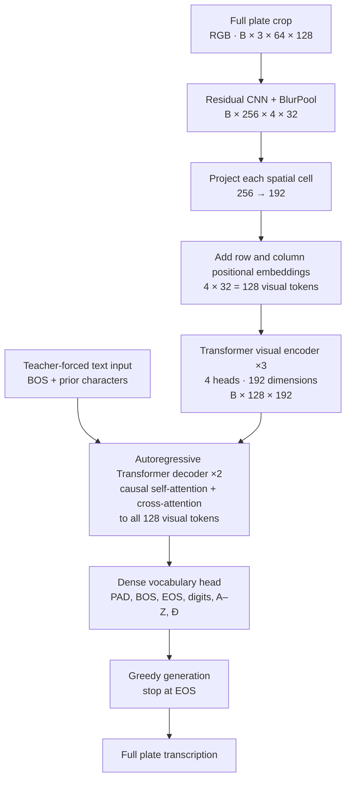

# Layout-free plate OCR — 2D Transformer encoder-decoder

This model reads the complete plate crop and full transcription. It does not require a separate `single`/`double` layout label, line crops, or character boxes.

Training labels are full plate strings. Encode each as `BOS + characters + EOS`, pad each batch, and apply teacher-forced cross-entropy while ignoring PAD. The decoder can attend to all image rows at every character step, so it can learn top-row-then-bottom-row output without an explicit layout target. This is an architectural hypothesis; it must be trained and evaluated on both layouts before claiming it works.

Current interface in `custom_alpr/custom_ocr.py`: `PlateOCR2D(images, decoder_input_ids)` returns `[batch, steps, vocabulary]`; `generate(images)` emits strings. A dataset loader, training loop, checkpoint management, and pipeline adapter are not implemented yet.

See [decoder flow](decoder-flow.md) for the query/key/value shapes, four attention heads, Dense classifier, and training behavior.
