# Transformer stages in PlateOCR2D

`PlateOCR2D` turns the CNN feature map into 128 visual tokens. The encoder processes all image tokens; the decoder uses those encoded tokens to generate the plate transcription one character at a time.

```mermaid
flowchart LR
    subgraph VIS[Visual tokens]
      V["CNN grid 4 × 32<br/>128 tokens × 192 dimensions"]
    end

    subgraph ENC[Transformer Encoder ×3]
      direction TB
      E0["Input visual tokens<br/>B × 128 × 192"] --> E1["Multi-head self-attention<br/>4 heads · residual + LayerNorm"]
      E1 --> E2["Feed-forward network<br/>192 → 768 → 192<br/>residual + LayerNorm"]
      E2 --> E3["Repeat encoder layer 3 times total<br/>Output memory: B × 128 × 192"]
    end

    subgraph DEC[Autoregressive Transformer Decoder ×2]
      direction TB
      T["Text prefix<br/>BOS, then prior characters"] --> T0["Token + position embeddings<br/>B × L × 192"]
      T0 --> D1["Masked multi-head self-attention<br/>4 heads · causal mask"]
      D1 --> D2["Cross-attention · 4 heads<br/>Q: text states<br/>K,V: all 128 encoder tokens"]
      D2 --> D3["Feed-forward network<br/>192 → 768 → 192"]
      D3 --> D4["Repeat decoder layer 2 times total"]
      D4 --> D5["LayerNorm + Dense<br/>192 → 40 token logits"]
      D5 --> PICK["Choose next token<br/>use final position logits"]
      PICK --> STOP{"EOS or length limit?"}
      STOP -- "No: append token" --> T
      STOP -- "Yes" --> OUT["Plate transcription"]
    end

    V --> E0
    E3 --> D2
```

## What each stage does

- **Encoder self-attention:** lets each visual token exchange information with the other cells in the 4 × 32 feature grid. It does not emit characters.
- **Decoder masked self-attention:** lets each text position use the prefix up to that position while blocking future characters.
- **Decoder cross-attention:** lets each text position read from all 128 encoded image tokens at every decoder layer.
- **Autoregressive loop:** inference starts with `BOS`, selects one next token, appends it to the prefix, and repeats until `EOS` or the configured length limit.

The encoder has 3 layers and the decoder has 2 layers. These counts describe repeated processing blocks; they do not mean the encoder produces three characters or the decoder produces two characters. During training, teacher forcing supplies the known prefix instead of feeding back the model's prediction at each step.
